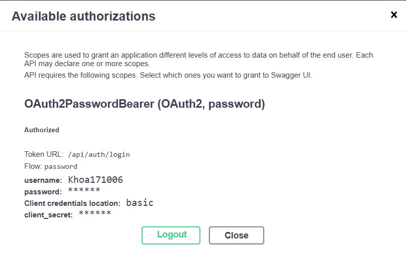
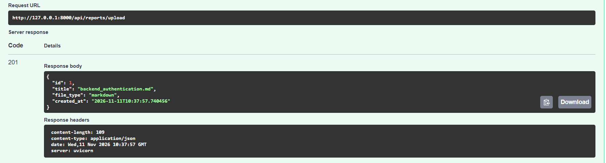

# BÁO CÁO KỸ THUẬT: Hoàn thiện hệ thống api crud và endpoint upload báo cáo cho dự án AI - PORTFOLIO.

- **Ngày thực hiện:** [2026-11-11]
- **Tác giả:** Dương Công Khoa
- **Phân loại:** Dự án thực tế, Học tập
- **Trạng thái:** Đang thực hiện
- **Vai trò:** Người học và làm dự án

---

## 1. BỐI CẢNH & MỤC TIÊU (CONTEXT & OBJECTIVES)

### 1.1. Bối cảnh
Dự án AI Portfolio cần xây dựng hệ thống Backend để quản lý thông tin cá nhân, dự án, kỹ năng, tài liệu báo cáo và tiếp nhận tin nhắn liên hệ. Vì vậy, cần phát triển các API để kết nối Frontend với cơ sở dữ liệu và chuẩn bị dữ liệu đầu vào cho các chức năng AI trong tương lai.

### 1.2. Mục tiêu
- Hoàn thiện toàn bộ các cổng giao tiếp API CRUD cho thông tin dự án, danh mục kĩ năng và tin nhắn liên hệ.
- Thiết lập endpoint `api/reports/upload` hỗ trợ nhận file định dạng (.pdf, .docx, .png, .jpg) phục vụ cho Engine bóc tách AI về sau.


### 1.3. Phạm vi thực hiện
- Xây dựng Pydantic Schema cho Project, Skill, Report và ContactMessage.
- Phát triển API lấy và thêm Project, Skill.
- Xây dựng API upload báo cáo và ảnh scan.
- Xây dựng API gửi và quản lý tin nhắn liên hệ.
- Tích hợp JWT Bearer Token để bảo vệ các API dành cho Admin.
- Đăng ký Router và kiểm thử API bằng Swagger UI.
- Chưa triển khai chức năng AI bóc tách nội dung tài liệu và RAG.

---

## 2. CÔNG NGHỆ & CÔNG CỤ SỬ DỤNG (TECH STACK & SKILLS)

Liệt kê công nghệ, công cụ và vai trò cụ thể của từng thành phần.

| Công nghệ / Công cụ | Vai trò trong dự án | Mức độ sử dụng |
|---|---|---|
| FastAPI | Xây dựng REST API và UploadFile | 3.0 |
| Pydantic | Validate và chuẩn hóa dữ liệu | 3.0 |
| SQLAlchemy | Truy vấn và thao tác với database | 2.0 |
| JWT / OAuth2 | Xác thực và phân quyền admin | 2.5 |
| Python | Ngôn ngữ lập trình python | 4.0 |
| uv | Quản lý thư viện và môi trường | 4.5 |
| Swagger UI | Kiểm thử API | 4.0 |


### 2.1. Công nghệ chính
- **FastAPI:** Xây dựng các API và quản lý Router.
- **Pydantic:** Kiểm tra và chuẩn hóa dữ liệu đầu vào, đầu ra.

### 2.2. Kiến thức và kỹ năng áp dụng
- Kiến thức RESTful API, HTTP Request/Response và CRUD.
- Kỹ năng xây dựng Backend Router, Schema và ORM.
- Kỹ năng xác thực JWT, phân quyền Admin và xử lý lỗi API.
- Kỹ năng kiểm thử và xử lý lỗi trong quá trình phát triển.

---

## 3. QUÁ TRÌNH TRIỂN KHAI & CHỨNG CỨ THỰC HÀNH (IMPLEMENTATION & EVIDENCE)

Mô tả những công việc thực tế đã thực hiện. Ưu tiên bằng chứng có thể kiểm chứng.

### 3.1. Các bước triển khai

**Bước 1: Tạo Schema Pydantic cho Dữ liệu Portfolio & Report**
- Mô tả: Định nghĩa các Schema Pydantic quản lý thông tin Project, Skill, Report và ContactMessage.
- Kết quả: Hoàn thành các Schema Pydantic cho Project, Skill, Report và Contact
- Công nghệ sử dụng: python, pydantic

**Bước 2: Viết Router CRUD Dự án & Kỹ năng**
- Mô tả: Xây dựng Router `portfolio.py` tách biệt giữa tuyến API lấy dữ liệu công khai và tuyến thêm dữ liệu yêu cầu Bearer Token Admin.
- Kết quả: Hoàn thành API lấy danh sách và thêm Project, Skill; bảo vệ các API thêm dữ liệu bằng Bearer Token Admin và kiểm tra kỹ năng trùng lặp
- Công nghệ sử dụng: Python, FastAPI

**Bước 3: Viết Router Upload Báo cáo/Ảnh scan**
- Mô tả: Phát triển Router `reports.py` với cơ chế kiểm tra đuôi file mở rộng và phân loại tệp tự động
- Kết quả: Hoàn thành API upload báo cáo và ảnh scan, kiểm tra định dạng file hợp lệ, tự động phân loại và lưu thông tin file vào cơ sở dữ liệu. API được bảo vệ bằng Bearer Token Admin.
- Công nghệ sử dụng: Python, FastAPI, SQLAlchemy

**Bước 4: Viết Router Liên hệ**
- Mô tả: Xây dựng Router contacts.py hỗ trợ tiếp nhận tin nhắn từ khách truy cập và quản lý danh sách tin nhắn dành cho Admin.
- Kết quả: Xây dựng Router contacts.py hỗ trợ tiếp nhận tin nhắn từ khách truy cập và quản lý danh sách tin nhắn dành cho Admin.
- Công nghệ sử dụng: Python, FastAPI, SQLAlchemy

**Bước 5: Đăng ký các Routers vào file main và test**
- Mô tả: Đăng ký các Router Auth, Portfolio, Contacts và Reports vào `app/main.py`, kiểm tra hoạt động của các Endpoint thông qua Swagger UI.
- Kết quả: Đăng ký thành công các Router, đăng nhập Admin bằng OAuth2 và kiểm thử các API công khai, API quản trị và chức năng upload file.
- Công nghệ sử dụng: Python, FastAPI, Swagger UI, OAuth2, JWT.


### 3.2. Kiến trúc và thiết kế kỹ thuật
Hệ thống Backend được xây dựng theo mô hình phân chia thành các tầng chức năng:
- Routers: Tiếp nhận HTTP Request và xử lý các Endpoint.
- Schemas: Kiểm tra và chuẩn hóa dữ liệu bằng Pydantic.
- Models: Định nghĩa cấu trúc bảng dữ liệu bằng SQLAlchemy ORM.
- Database: Lưu trữ thông tin trên PostgreSQL thông qua SQLAlchemy Session.
- Core/Dependencies: Quản lý xác thực JWT và kiểm tra quyền Admin.  

Các API công khai cho phép người dùng lấy dữ liệu và gửi tin nhắn. Các API quản trị yêu cầu xác thực Bearer Token trước khi thực hiện thao tác.

### 3.3. Chứng cứ thực hành (Evidence)

| Loại bằng chứng | Mô tả | Đường dẫn / Link |
|---|---|---|
| Screenshot | Giao diện đăng nhập thành công bằng bảng authozi của Swagger UI |  |
| API / Demo | Kết quả test API upload file |  |

---

## 4. THÁCH THỨC & BÀI HỌC KINH NGHIỆM (CHALLENGES & KEY LEARNINGS)

### 4.1. Thách thức gặp phải
#### 4.1.1: Lỗi chưa cài thư viện.
- **Vấn đề:** ModuleNotFoundError: No module named 'email_validator'. FastAPI cần thư viện `python-multipart` để xử lý dữ liệu
- **Nguyên nhân:** Mình đang sử dụng Emailstr mà chưa cài thư viện Email-validator. Và chưa cài thư viện xử lý dữ liệu của python
- **Ảnh hưởng:** Khi chạy dự án FastAPI thì báo lỗi

#### 4.1.2:  Giải pháp xử lý
- **Phương pháp:** Cài thêm thư viện `email-validator` cho dự án và chạy lại.
- **Các bước thực hiện:**
```text
uv add email-valdator
uv add python-multipart
```
- **Kết quả:** Đã không còn lỗi và đã test được trên trang Swagger UI

#### 4.2.1: Lỗi 422 Unprocessable content khi test API bằng bảng authorizations trên trang swagger UI
- **Vấn đề:** Khi đã đăng nhập được và có access token rồi nhưng không thể test các API còn lại bảng authorization trên swagger UI.
- **Nguyên nhân:** Định dạng dữ liệu đăng nhập không khớp giữa Swagger UI và API login của tôi
- **Ảnh hưởng:** Khi đã có access token rồi nhưng không test được các API khác dành cho admin.

#### 4.2.2: Giải pháp xử lý
- **Phương pháp:** Dùng AI xác định lỗi và hướng dẫn giải quyết vấn đề hiện tại.
- **Các bước xử lý:** Sửa API login và cách lấy dữ liệu bằng OAuth2PasswordRequestForm
- **Kết quả:** Đã đăng nhập được bằng Swagger UI và test được API upload file thành công.

---

## 5. KẾT QUẢ & ĐÁNH GIÁ (RESULTS & EVALUATION)

### 5.1. Kết quả đạt được
- Hoàn thành xây dựng các Router và Schema cho Project, Skill, Report và ContactMessage.
- Tích hợp xác thực JWT, phân quyền Admin và kiểm soát truy cập API.
- Kiểm thử thành công các API bằng Swagger UI, bao gồm chức năng upload báo cáo và ảnh scan.

### 5.2. Đánh giá mức độ thành thạo

| Công nghệ / Kỹ năng | Điểm tự đánh giá (1.0 - 5.0) | Cơ sở đánh giá |
|---|---:|---|
| python | 4.0 | Xây dựng được các module backend |
| FastAPI | 3.5 | Xây dựng và đăng kí được router API |
| Pydantic | 3 | Thiết kế Schema và Validation |
| SQLAlchemy | 2.5 | Thao tác với dữ liệu database |
| JWT / OAuth2 | 3 | Xác thực và phân quyền admin |
| Swagger UI | 4 | Kiểm thử các endpoint API |

### 5.3. Hạn chế hiện tại
- API Project và Skill hiện mới triển khai chức năng thêm và lấy danh sách, chưa hoàn thiện Update và Delete.
- Chức năng upload mới lưu file và đường dẫn trong Database, chưa thực hiện bóc tách nội dung bằng AI.
- Chưa triển khai giới hạn dung lượng file và kiểm tra nội dung thực tế của file tải lên.
- Chưa xây dựng hệ thống tự động kiểm thử API bằng Unit Test.
---

## 6. ĐỊNH HƯỚNG PHÁT TRIỂN (FUTURE IMPROVEMENTS)
- Hoàn thiện đầy đủ CRUD cho Project và Skill.
- Bổ sung chức năng đọc và bóc tách nội dung từ PDF, DOCX và ảnh scan bằng AI/OCR.

---
